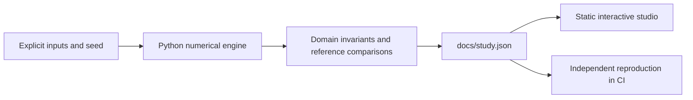

# Research Evidence Observatory

An inspectable bridge from experiments to evidence-based research.

**[Open the interactive research studio](https://fyodoramanov1.github.io/ai-research-workbench/)** · [Measured study](docs/study.json) · [Technical case study](reports/applied-study.md) · [Source](src/studio.py)

Build an evidence-driven AI research interface around actual experiment artifacts, with inspectable provenance and bounded integration.

## What you can do

- **Evidence explorer:** Search actual experiment records across four public research projects. Every result carries its source URL, content digest, measured metrics and limitations. No model or API is called by this offline explorer.
- **Claim audit & integration:** A numeric claim must name an existing experiment, a recorded metric, its exact unit and a matching value. Export source-labelled context for evidence-based analysis.

The interface selects recorded experiments, toggles chart series and exports the comparison table. Each view includes the method, assumptions, provenance and its reproduce command. No API key is required. Market Replay additionally plays the actual book snapshots; the Evidence Observatory performs local retrieval and numeric-claim checks.

## Reproduce

Python 3.12; CPU only. From this repository:

```powershell
python -m pip install -r requirements.txt
python src/studio.py --out docs/study.json
python -m http.server 8000 --directory docs
```

Open `http://localhost:8000`. The static app fetches its local JSON, so use HTTP rather than opening `index.html` directly. No JavaScript build step or package installation is needed.

CI reproduces every applied case with `python src/studio.py --check docs/study.json`, checks numerical invariants and retains the original independent numerical contract. New applied code lives under `src/`; `lab.py` and its original CLI remain compatible for the existing research milestones.

## Recorded findings

### Evidence explorer

- Public experiment records: **10 **
- Top-1 authored regression accuracy: **92.3077 %**
- Top-3 authored regression accuracy: **92.3077 %**
- Unsupported-topic abstentions: **2 **

### Claim audit & integration

- Claim probes matching specification: **5 **
- Rejected invalid claims: **4 **
- Exported context size: **7522 chars**
- External provider calls: **0 **

## Interpretation

All expected-source questions retrieve the registered record, while the misleading guaranteed-profit question exposes lexical false support. Two unrelated-topic questions abstain. The numeric validator catches transcription errors; it cannot turn an unsupported scientific conclusion into evidence.

## Design




## Scientific boundaries

Registry derived solely from the four public companion study artifacts. No unpublished research, credentials or paper text is ingested.

- Thirteen authored regression questions are small development fixtures, not an independent held-out benchmark. Failed queries remain in the table.
- The guaranteed-profit question deliberately shares corpus terms but has no supporting answer: BM25 retrieves anyway. Empty-lexical-support abstention does not detect semantic false support. No semantic answer correctness or hallucination rate is estimated.
- Snapshots can become stale. Source artifact digests identify exactly which local public report was ingested; re-ingestion is explicit. Registry hashes detect accidental edits, not a malicious party able to rewrite both data and hashes.
- Matching a recorded number verifies transcription only. It does not validate the underlying study or establish causality, profitability or quantum advantage.
- Five specified claim probes demonstrate interface behavior, not robustness to all adversarial inputs. JSON boundaries and instructions do not guarantee an LLM will resist prompt injection.
- The browser and CLI use deterministic retrieval and do not generate prose using an LLM.

## Next research questions

- Freeze retrieval rules, then author independent confirmation questions and report false support separately from empty retrieval.
- Add compatible experiment comparisons that reject unit, dataset and protocol mismatches.
- Add explicit registry refresh and stale-artifact diagnostics while retaining source IDs and full evidence boundaries.

## References

- [BM25: The Probabilistic Relevance Framework](https://www.staff.city.ac.uk/~sbrp622/papers/foundations_bm25_review.pdf)
- [Retrieval-augmented generation](https://arxiv.org/abs/2005.11401)

## Development history

The original baseline and milestone reports are preserved under `reports/`; the applied study is a separate artifact. Results are measured simulations, not claims of live profitability, quantum advantage or independent research novelty. MIT license.
